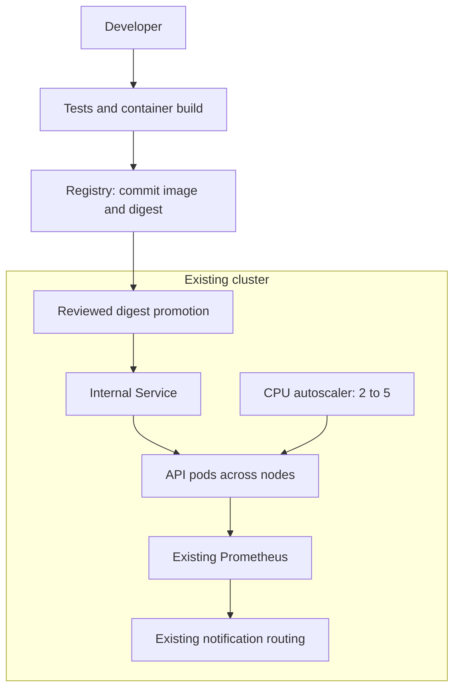

# DevOps Engineer skill — worked example

**Fictional request:** “We run a small Python API on Kubernetes. Prepare a safer
release process, health checks, autoscaling and Prometheus alerts. Include a
rollback runbook and a local lab to test a failed release and recovery. Use an
existing cluster; don't create cloud resources.”

This is a NEW educational scaffold, not an inspection or repair of a real user's
system. The failure mode is intentionally simulated. No cloud account is used.

## Assumptions and acceptance criteria

Existing Kubernetes, metrics-server and Prometheus; stateless internal HTTP API;
two schedulable nodes. No databases, public ingress, TLS certificates or cloud
provisioning are needed for this bounded lab. If externally exposed, put it behind
the team's authenticated TLS ingress; the Python standard-library HTTP server
is deliberately limited and requires replacement/hardening for public production.

Accept locally: health and business routes return 200; a simulated defective
release returns 503 even with green probes; metrics reflect failures; restoring
the good release recovers GET /; SIGTERM exits cleanly; a bounded concurrent
request sample has no errors. Accept in staging later: server-side manifest
validation, two ready replicas, healthy per-pod scrapes, HPA scaling within 2-5,
controlled rollout/rollback and tested notification routing.

## Try it

Python 3.12+; no Python packages needed for runtime or local integration tests:

```sh
python3 tests/verify.py
python3 app.py
# In a second terminal:
curl --fail http://127.0.0.1:8080/
curl --fail http://127.0.0.1:8080/metrics
```

Ctrl-C stops the manual server. Tests own and terminate all their child processes.
Use docs/RUNBOOK.md for the container/cluster path, incident decisions and cleanup.

## Architecture



The registry-to-operator path is delivery; Service-to-pods is runtime traffic.
ClusterIP keeps the Service internal but does not isolate it from other pods.
No network policy is supplied because caller labels and CNI are unknown; add
an allowlist policy once those are known. Workload has no Kubernetes API token,
cloud credentials, secret requirements or persistent data. Monitoring discovery
uses its own scoped Role. No customer data or raw URLs are logged.

## Files and decisions

- app.py and tests/verify.py: executable local failure/recovery exercise.
- Dockerfile: non-root, minimal context, no dependencies or credentials.
- k8s/app.yaml: rollout probes, resources, spread, disruption budget and HPA.
- monitoring/: pod discovery, scoped RBAC and sustained-impact rules.
- .github/workflows/ci.yaml: PR tests/container smoke checks, main-only registry
  publication, scoped permissions and bounded execution. Deployment is a separate
  reviewed digest promotion. The publish job smoke-tests its release image before pushing that same
  image; staging must also verify the promoted digest in the cluster. Base images/action tags must be reviewed and pinned to immutable digests/
  commit SHAs before production. Add the organization's vulnerability gate.
- docs/RUNBOOK.md: deployment, debugging, rollback, capacity and cleanup.
- VERIFICATION.md: measured checks and what remains unverified.

## Official references consulted

- https://kubernetes.io/docs/concepts/workloads/autoscaling/horizontal-pod-autoscale/
- https://kubernetes.io/docs/tasks/configure-pod-container/configure-liveness-readiness-startup-probes/
- https://prometheus.io/docs/prometheus/latest/configuration/recording_rules/
- https://docs.github.com/en/actions/tutorials/publish-packages/publish-docker-images
